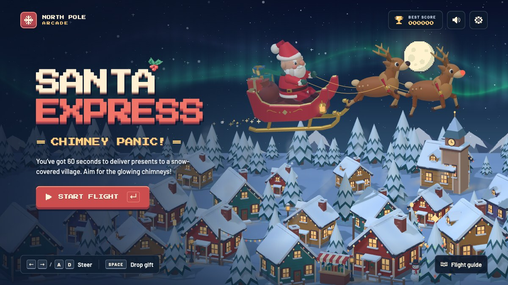

# Santa Express: Chimney Panic!

**[Spill Santa Game](https://thestringtheories.github.io/Santa-Game/)**



Fly Santa’s sleigh over a Nordic village and deliver as many presents as possible in 60 seconds. A dotted line predicts each landing. When the marker meets a chimney, its ring turns mint and **DROP!** appears. Press Space to send the gift down.

## Controls

| Action | Control |
| --- | --- |
| Start a flight or fly again | Enter or the red play button |
| Skip the opening fly-through | Enter, Space, Escape or **Skip intro** |
| Steer | A / D or left / right arrow |
| Drop one present | Space |
| Pause | Escape or P |
| Toggle sound | M or the speaker button |

Touch devices have on-screen steering and drop buttons. A delivery earns 100 points times the current streak, up to a ×5 multiplier. A missed throw resets the streak. The sleigh accelerates during the round. Presents released before the bell can still score.

**Fly again** restarts immediately. **Copy score** copies the result and game link for sharing. Best score, sound and graphics preferences are saved in the current browser.

## Graphics

Open the gear button to choose **Low**, **Medium** or **High**. Medium is the default. The presets adjust shadow quality, snowfall, smoke and celebration effects. Each preset can lower its rendering resolution during slow frames and raise it again when there is headroom. Enable **Show FPS and render resolution** to see the frame rate and number of rendered pixels per CSS pixel.

The fly-through runs before the round timer starts. The game skips it when the browser requests reduced motion. Opening the guide or graphics settings pauses the flight.

## Run locally

Use Node.js 24 LTS and npm. From the repository root, run

```sh
npm ci
npm run dev
```

Open the local URL printed by Vite. For a production build and local preview, run

```sh
npm run build
npm run preview
```

The build type-checks the TypeScript source and writes static files to `dist/`. The game requires a browser with WebGL 2. Sound is synthesized with the Web Audio API.

## Deploy

**GitHub Pages.** The repository uses GitHub Actions as its Pages source. Every push to `main` installs the locked dependencies, builds the game and deploys `dist/`. Relative asset paths support the `/Santa-Game/` project address. [Publication workflow](.github/workflows/pages.yml)

**Vercel.** Import this repository as a new project. Select the **Vite** framework preset, keep the repository root as the project directory, use `npm run build` as the build command and `dist` as the output directory, then deploy. The same build works at a root domain. [Vite on Vercel](https://vercel.com/docs/frameworks/frontend/vite)

## How the village is built

Three.js renders the sleigh, articulated reindeer, houses, mountain ranges and snowfall. The game batches static geometry, instances repeated trees and confetti, and recycles village sections as the sleigh moves. Animated aurora, window glows and chimney celebrations use small shaders and procedural textures.

The project bundles Three.js, Barlow and Press Start 2P. Their license notices ship with the game. [Licenses](public/licenses/)
