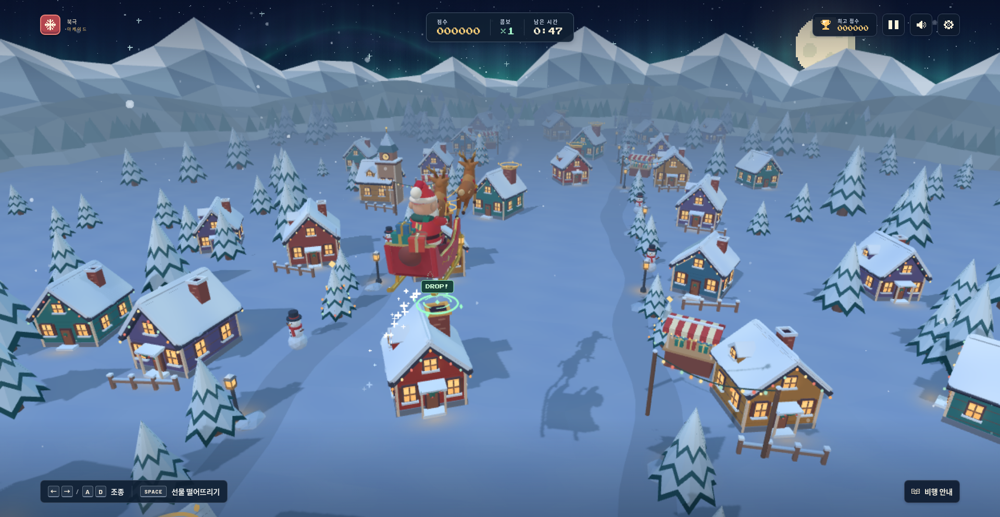
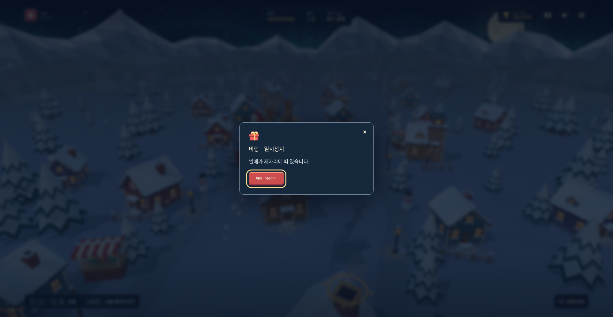
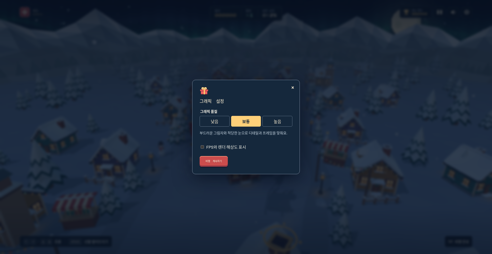

# 산타 익스프레스: 굴뚝 대소동! (한국어판)

60초 안에 산타의 썰매를 몰아 북유럽 마을 위를 날며, 빛나는 굴뚝에 선물을 떨어뜨리는 3D 크리스마스 아케이드 게임입니다. 종이 울리기 전에 몇 개나 배달할 수 있을까요?

**[한국어판 바로 플레이](https://sigco3111.github.io/santa-game-ko/)**

> 원작 [thestringtheories/Santa-Game](https://github.com/thestringtheories/Santa-Game)을 포크해 화면 문구를 한국어로 옮긴 버전입니다. 원작 영어 README는 [README.en.md](README.en.md)에 그대로 보존했습니다.

[](https://sigco3111.github.io/santa-game-ko/)

## 화면

한국어판 배포 빌드에서 직접 캡처한 화면입니다.

| 시작 화면 | 비행 중 (HUD: 점수·콤보·남은 시간) |
| --- | --- |
|  |  |

| 일시정지 | 그래픽 설정 | 결과 화면 |
| --- | --- | --- |
|  |  |  |

## 한국어판에서 바뀐 것

- 시작 화면, 버튼, 안내창, 결과 화면, 설정 화면 등 `index.html`의 문구를 한국어로 옮기고 한글 웹폰트(Noto Sans KR)를 추가했습니다.
- 게임 안에서 코드로 띄우는 문구(소리 켜기/끄기, 비행 시작·완료 안내, 그래픽 설정 설명, 점수 복사, 터치 안내, WebGL 오류 문구 등)는 원본 소스를 고치지 않고, 빌드할 때 `vite.config.ts`의 치환 설정으로 한국어로 바꿉니다.
- 게임 로직, 변수 이름, 에셋 파일은 바꾸지 않았습니다.
- 방문 통계나 분석 스크립트는 원작에도 없고, 한국어판에도 넣지 않았습니다. 점수와 설정은 브라우저(localStorage)에만 저장됩니다.

## 조작법

점선이 썰매 아래를 가리킵니다. 굴뚝 링이 민트색으로 바뀌고 **DROP!**이 뜨면 Space를 누르세요.

| 동작 | 조작 |
| --- | --- |
| 비행 시작 / 다시 비행 | Enter 또는 빨간 플레이 버튼 |
| 오프닝 건너뛰기 | Enter, Space, Esc 또는 건너뛰기 버튼 |
| 조향 | A / D 또는 좌우 방향키 |
| 선물 투하 | Space |
| 일시정지 | Esc 또는 P |
| 소리 켜기/끄기 | M 또는 스피커 버튼 |

터치 기기에서는 화면의 조향 버튼과 투하 버튼을 쓸 수 있습니다. 배달에 성공하면 현재 연속 횟수에 100점을 곱한 점수를 얻고, 최대 ×5배까지 올라갑니다. 투하를 놓치면 연속 횟수가 처음으로 돌아갑니다. 썰매는 라운드가 진행될수록 빨라지고, 종이 울리기 전에 던진 선물은 그 뒤에도 점수가 됩니다.

원작 README 기준으로, 최고 점수·소리·그래픽 설정은 사용하는 브라우저에 저장됩니다. **점수 복사**는 결과와 게임 링크를 복사해 공유할 수 있게 해 줍니다.

## 그래픽 설정

톱니바퀴 버튼에서 **낮음 / 보통 / 높음**을 고를 수 있고, 기본값은 보통입니다. 그림자 품질, 눈, 연기, 축하 효과가 달라지며, 프레임이 떨어지면 렌더링 해상도를 낮췄다가 여유가 생기면 다시 올립니다. 오프닝 비행은 라운드 타이머 전에 진행되며, 브라우저가 모션 줄이기를 요청하면 건너뜁니다.

## 로컬 실행

Node.js 24 LTS와 npm이 필요합니다. 저장소 루트에서 다음을 실행하세요.

```sh
npm ci
npm run dev
```

Vite가 알려 주는 로컬 주소를 열면 됩니다. 프로덕션 빌드와 미리보기는 다음과 같습니다.

```sh
npm run build
npm run preview
```

빌드는 TypeScript를 검사한 뒤 `dist/`에 정적 파일을 만듭니다. WebGL 2를 지원하는 브라우저가 필요하고, 소리는 Web Audio API로 합성합니다.

## 배포

GitHub Pages(GitHub Actions)로 배포합니다. `main`에 푸시하면 의존성을 설치하고 빌드한 뒤 `dist/`를 올립니다. 워크플로는 [.github/workflows/pages.yml](.github/workflows/pages.yml)입니다.

## 원작과 라이선스

- 원작: [thestringtheories/Santa-Game](https://github.com/thestringtheories/Santa-Game) (원작자 thestringtheories)
- 제작 방식: 원작 README에 따르면 GPT-6.2 Astra에 3D 크리스마스 게임을 요청하는 프롬프트 하나로 시작해 만든 프로젝트입니다.
- **라이선스 상태: 미표기.** 원작 저장소에는 LICENSE 파일이 없고 README에도 라이선스 표기가 없습니다. 이 한국어판은 원작의 라이선스 조건을 새로 부여하지 않으며, 원작자의 요청이 있으면 즉시 내리겠습니다.
- 원작 README에 따르면 게임에는 Three.js, Barlow, Press Start 2P가 포함되어 있고, 각 라이선스 고지는 [public/licenses/](public/licenses/)에 들어 있습니다. 한국어판에서도 그대로 유지했습니다.
- 한글 표시를 위해 Google Fonts의 Noto Sans KR 웹폰트를 추가로 불러옵니다(SIL Open Font License).
